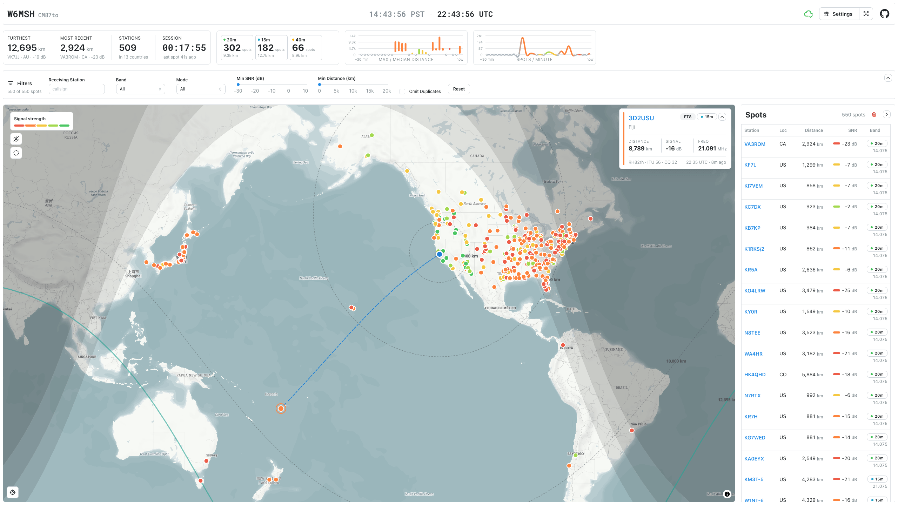

# QSA Dashboard

QSA Dashboard is a cross-platform desktop and web based dashboard created by Mike Chambers (W6MSH) for tracking realtime amateur radio signal propagation for digital modes.

It provides insight into how your signal is propagating, as well as antenna performance and band conditions for the station you are tracking.

You can install it locally (web or desktop) as well as use it at [https://w6msh.mikechambers.com/](https://w6msh.mikechambers.com/).

Data is sourced via MQTT feed from [PSKReporter](https://www.mqtt.pskreporter.info/).

[](images/screenshot-expanded.png?raw=true)

<a href="images/screenshot-collapsed.png"></a>
<a href="images/screenshot-filters.png"></a>
<a href="images/screenshot-settings.png"></a>
<a href="images/screenshot-dark.png"></a>

[Screenshots](images/)

**Features**

**_ Web _**

- Realtime spot (who hears you) information, including location, distance and strength
- Plot spots on world map
- Filter data
- Light / dark modes
- Charts and data analysis

**_ Desktop _**
All of the above and:

- Mac, Windows and Linux desktop client
- WSJT-X integration (direct and multicast)
- Heard spot (who you hear) information, including location, distance and strength (with WSJT-X integration)
- Realtime CQ calls and mapping (with WSJT-X integration)
- Initiate CS reply from app (with WSJT-X integration)

**Supported Modes**

- FT8
- FT4
- JS8
- VARAC
- CW
- MFSK
- JT9
- JT65
- PSK31
- PSK63
- RTTY
- SSB
- OLIVIA

Spots in any other mode are still shown, with the mode listed as UNKNOWN.

## Installation

There are two versions. The web version runs in your browser. The desktop version runs on Mac, Windows and Linux, and adds WSJT-X integration and offline maps.

### Web

You can use the hosted web version at [https://w6msh.mikechambers.com/](https://w6msh.mikechambers.com/).

#### Requirements

- [Node.js](https://nodejs.org) 22.22 or newer (24 LTS recommended)
- Online connection

#### Download and run locally

Download the zip file, or clone via git.

```
$ cd qsa-dashboard-js
$ npm install
$ npm run dev
```

Then point your browser to the dev url (printed out in terminal when you run it).

#### Build your own

```
$ npm run build
```

This writes a static site to the `dist` folder, which you can host on any web server. Serve it from the root of the domain, and have the server return `index.html` for paths that don't match a file, so that links such as `/dashboard/W6MSH/FN31` work.

To check the build locally before you upload it:

```
$ npm run preview
```

### Desktop

#### Download and run

Download the installer for your system from the [releases page](https://github.com/mikechambers/qsa-dashboard-js/releases).

Maps are included with the app, but you still need an online connection to receive spots (who can hear your signal).

To use the WSJT-X features, open **Settings**, select **WSJT-X** and turn on **Connect to WSJT-X**. The port must match the UDP server port in WSJT-X.

#### Build your own

You can only build for the system you are on.

##### Requirements

- [Node.js](https://nodejs.org) 22.22 or newer (24 LTS recommended)
- [Rust](https://rustup.rs) 1.90 or newer
- The [Tauri system requirements](https://v2.tauri.app/start/prerequisites/) for your system (Xcode Command Line Tools on Mac, C++ Build Tools and WebView2 on Windows, WebKitGTK and other packages on Linux)
- `git`, `bash` and the [pmtiles command line tool](https://github.com/protomaps/go-pmtiles/releases), to download the maps
- Online connection

##### Download the source and maps

Download the zip file, or clone via git.

```
$ cd qsa-dashboard-js
$ npm install
$ npm run fetch-map -- YYYYMMDD
```

Replace `YYYYMMDD` with a recent build date. The maps are required before you can run or build the app. See [Offline maps](#offline-maps-desktop-app) for details.

##### Run in development

```
$ npx tauri dev
```

##### Build the app

```
$ npx tauri build
```

The app and installers are written to `src-tauri/target/release/bundle`.

### Demo mode

If you want to play around without transmitting, turn on **Add Mock Spots** (under **Settings** > **Display**), which will prepopulate the app with mock spots.

## Usage

### Enter station details

On first launch, you will be prompted to enter your station details.

- _Callsign_ **(required)** : Your amateur radio call sign, or the callsign that you plan to track.
- _Grid Location_ Your [maidenhead grid location](https://www.levinecentral.com/ham/grid_square.php) (4 - 6 chars), used to show your location on the map, determine distance and display propagation routes. It is optional, but without it there is no home marker, path line or distance rings.

Once you have entered your station details, click "Update station" to load the dashboard.

The dashboard URL includes your callsign and grid (for example `/dashboard/W6MSH/FN31`), so you can bookmark or share it.

### Begin transmitting on supported digital modes

Data is obtained from a live feed of propagation submissions to [PSKReporter](https://www.mqtt.pskreporter.info/).

You do not need any particular app to transmit, as long as you are transmitting a supported digital mode.

All that is required is that the receiver is using an app that reports viewed transmissions to PSKReporter (and the app has the reporting enabled).

### Interact with and filter data

In web mode, you can view information (spots) from stations that can hear your signal.

Data is retained per session, with a maximum of 3,000 spots (older ones drop off).

You can hover over a spot in the table or on the map to select it, and its details will be displayed.

### WSJT-X (desktop app)

Connect the desktop app to WSJT-X to see the stations you are hearing, along with who hears you.

#### Set up WSJT-X

In WSJT-X, open **Settings** > **Reporting**, and under **UDP Server**:

- Note the server address and port. The defaults are `127.0.0.1` and `2237`.
- Turn on **Accept UDP requests** if you want to reply to CQs from the dashboard.

#### Connect the dashboard

1. Open **Settings** and select **WSJT-X**.
2. Check that **Connect to WSJT-X** is on (it is by default).
3. If you changed the address or port in WSJT-X, enter them and click **Update connection**.

The status below the button shows **Connected** once messages arrive from WSJT-X.

- **Same computer:** the default address, `127.0.0.1`, works.
- **WSJT-X on another computer:** in the dashboard, enter the network address of the computer running the dashboard, and set the UDP server in WSJT-X to that same address.
- **Sharing with other programs:** to use another program that listens to WSJT-X (such as a logger) at the same time, use a multicast address (for example `239.255.0.1`) in WSJT-X and in each program.

#### What you will see

In addition to Spots (who sees your signal), when using WSJT-X you will also see:

- **Heard** stations: those you have decoded / received.
- **CQ** stations: those calling CQ on your current band.
- Lines on the map to stations that are **calling you**, and the station you are **working**.
- The **Furthest Heard** distance, and its ring on the map.
- The band and mode WSJT-X is on, and whether it is decoding or transmitting.

Stations are listed once for each band you heard them on, and are kept for the session, even if you close WSJT-X. Only stations with valid maidenhead grids are displayed on the map.

#### Reply to a CQ

Click a CQ station, then click **Reply**. This is the same as double clicking its message in WSJT-X.

> **Warning:** Reply can put your radio on the air. Only click it if you are ready to transmit. While trying it out, disconnect the radio or use a dummy load.

If nothing happens, check that **Accept UDP requests** is on. If WSJT-X selects the station but does not transmit, press **Enable Tx** in WSJT-X.

### Filters

Use the filter bar to narrow what is shown across summaries, the map and table. Filters apply right away, to everything on the dashboard: the table, map, summary and charts.

|       **FILTER** | **DESCRIPTION**                                                                                                       |
| ---------------: | --------------------------------------------------------------------------------------------------------------------- |
|     **Callsign** | Only show stations whose callsign starts with this. For spots, this is the station that heard you.                    |
|         **Band** | Only show the selected band.                                                                                          |
|         **Mode** | Only show the selected mode.                                                                                          |
|          **Age** | Only show reports from the last 5, 15 or 30 minutes, or the last hour. The default is All.                            |
|         **Type** | _(desktop)_ Show All, or only Spot, Heard or CQ.                                                                      |
|      **Min SNR** | Hide signals weaker than this. For spots, this is how well they heard you. For Heard and CQ, how well you heard them. |
| **Min Distance** | Hide stations closer than this.                                                                                       |

**Reset** clears all of the filters. Apart from Type, filters are not saved, so they also reset when you reload or restart the app.

## Charts

There are currently two charts in web view:

### Max / Median Distance

This creates a floating bar chart displaying the max and median distance for each of the previous 30 minutes.

It is color coded based on the average signal strength (SNR).

### Spots / Minute

This displays the spots per minute, for each of the previous 30 minutes, color coding the line based on the average signal strength.

Note, due to the way that PSKReporter and apps handle duplicate / repeat spots, the initial minute will often be much higher than subsequent minutes, which omit repeated spots.

PSKReporter will resend duplicates, resetting every 5 minutes.

## Settings

Open settings with the **Settings** button in the web version. In the desktop app, choose **Settings** from the menu (`Cmd+,` on Mac, `Ctrl+,` on Windows and Linux).

### Station

Click **Update station** to save changes.

|           SETTING | DESCRIPTION                                                                                       |
| ----------------: | ------------------------------------------------------------------------------------------------- |
|      **Callsign** | _(required)_ The callsign whose signal you want to track.                                         |
| **Location Grid** | Your maidenhead grid (4 or 6 characters). Used for your location on the map, paths and distances. |

### WSJT-X (desktop app)

|               SETTING | DESCRIPTION                                                                |
| --------------------: | -------------------------------------------------------------------------- |
| **Connect to WSJT-X** | Off by default. When off, WSJT-X features are hidden on the dashboard.     |
|           **Address** | The address to listen on, direct or multicast. The default is `127.0.0.1`. |
|              **Port** | Must match the UDP server port in WSJT-X. The default is `2237`.           |

Click **Update connection** to save a new address or port.

### Display

|            SETTING | DESCRIPTION                                                                  |
| -----------------: | ---------------------------------------------------------------------------- |
|          **Theme** | Light or Dark.                                                               |
|          **Units** | Metric or Imperial.                                                          |
|      **Time Zone** | UTC or Local (your system time zone).                                        |
| **Add Mock Spots** | Demo mode: adds generated spot data. Requires a page refresh to take effect. |

### Map

|                SETTING | DESCRIPTION                                                                                                                  |
| ---------------------: | ---------------------------------------------------------------------------------------------------------------------------- |
|          **Grey Line** | Show the transition between day and night. Can be useful for timing band openings.                                           |
| **Horizon / twilight** | Which lines the grey line draws: Horizon, Civil, Nautical and Astronomical twilight. All but Astronomical are on by default. |
|     **Distance rings** | Turns the distance rings on or off. Rings need a location grid.                                                              |
|           **Distance** | Rings at fixed distances around your location, in your selected units.                                                       |
|       **Max distance** | A ring at the distance of the furthest spot shown. The desktop app also draws one (in blue) for the furthest station heard.  |

Grey Line and Distance rings can also be turned on and off with the buttons on the map.

Settings are saved on your computer, in the browser's local storage (or the desktop app's).

## Notes

- The first minute in the charts is often much higher than the minutes after it (see the note under Spots / Minute)
- Distance rings (especially large ones) can look distorted on the map due to how the map is projected
- The desktop app supports only one WSJT-X instance at a time. If more than one sends to it, their status gets mixed up, including the state of the Reply button, which can transmit.

## Development

There are a couple of tests included (mostly for callsign and grid validation), which you can run with:

```
$ npm test
```

### Offline maps (desktop app)

The web version loads its map from [Maptoolkit](https://maptoolkit.org). The desktop app uses map files bundled with it, from [Protomaps](https://protomaps.com), so the map works offline. These files are not checked into git, so you need to sync them locally before you build the desktop app.

#### Requirements

- Online connection (only while downloading)
- The [pmtiles command line tool](https://github.com/protomaps/go-pmtiles/releases) (on macOS: `brew install pmtiles`)

#### Download or update the maps

1. Pick a recent build date from [maps.protomaps.com/builds](https://maps.protomaps.com/builds). Only recent builds are kept.
2. Run the script with that date, in `YYYYMMDD` format:

```
$ npm run fetch-map -- 20261125
```

3. Restart the desktop app, or rebuild it, to pick up the new files.

The files are saved to `src-tauri/resources/map`. Running the script again replaces the tiles.

To change how much detail is included, edit `MAXZOOM` in `scripts/fetch-map.sh`. The default is 6, and each additional level roughly doubles the size of the tiles.

Fonts and icons come from [basemaps-assets](https://github.com/protomaps/basemaps-assets), pinned to a specific commit (`ASSETS_COMMIT` in the same script), so they only change if you update it.

### App icons

All of the icons are built from one file, `design/icon.svg`. To change the icon, edit that file and then run:

```
$ npm run icons
```

This replaces the desktop app icons in `src-tauri/icons` and the website icon, `public/favicon.svg`. Don't edit those by hand, as they are overwritten.

The macOS icons (`icon.icns` and `icon.png`) are given a transparent margin by the script, so they match the size of other icons in the Dock. The artwork needs a `viewBox` on its `<svg>` tag for this to work.

## Questions, Feature Requests, Feedback

If you have any questions, feature requests, issues or need help please post on the [issues page](https://github.com/mikechambers/qsa-dashboard-js/issues).

## Acknowledgements

Data is obtained from a live feed of propagation submissions to [mqtt.pskreporter.info](https://www.mqtt.pskreporter.info/), from data submitted to [PSKReporter](https://pskreporter.info).

Built with [React](https://react.dev), [Mantine](https://mantine.dev), [MapLibre GL JS](https://maplibre.org), [Turf.js](https://turfjs.org) for the distance rings and path lines, and the [ham2k](https://github.com/ham2k) libraries for DXCC and grid / distance calculations. Map styles in the web version are from [maptoolkit](https://www.maptoolkit.com), using [OpenStreetMap](https://www.openstreetmap.org/copyright) data.

The desktop app is built with [Tauri](https://tauri.app). Its offline map uses tiles, styles and icons from [Protomaps](https://protomaps.com), read with [PMTiles](https://github.com/protomaps/PMTiles), with data from [OpenStreetMap](https://www.openstreetmap.org/copyright) and [Natural Earth](https://www.naturalearthdata.com). Map labels use the Noto Sans font, under the [SIL Open Font License](https://openfontlicense.org).

Heard and CQ stations come from [WSJT-X](https://wsjt.sourceforge.io), by Joe Taylor (K1JT) and the WSJT development team.

## License

Project released under a [MIT License](LICENSE.md).

[](LICENSE.md)
