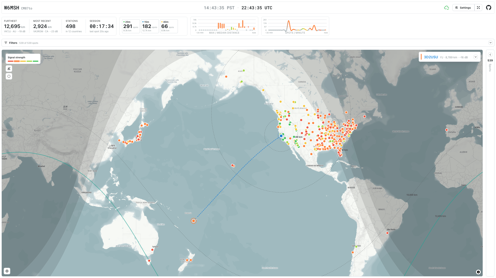
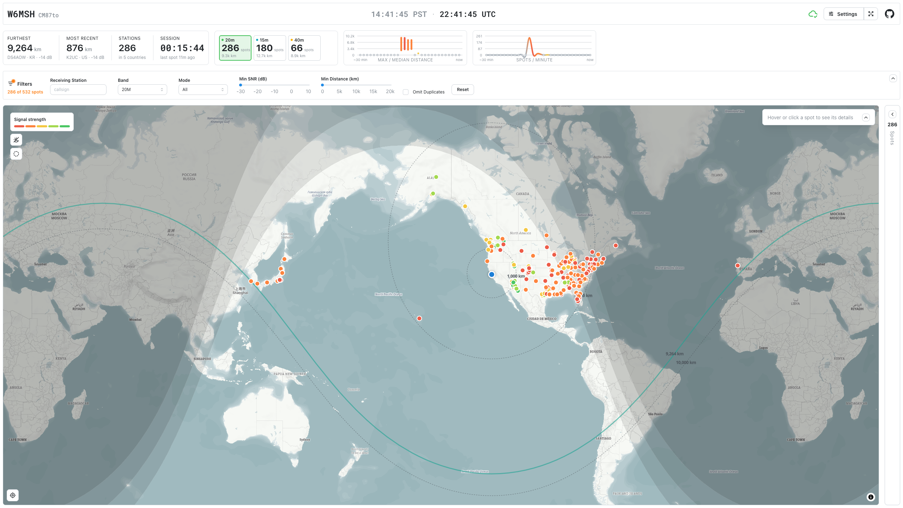
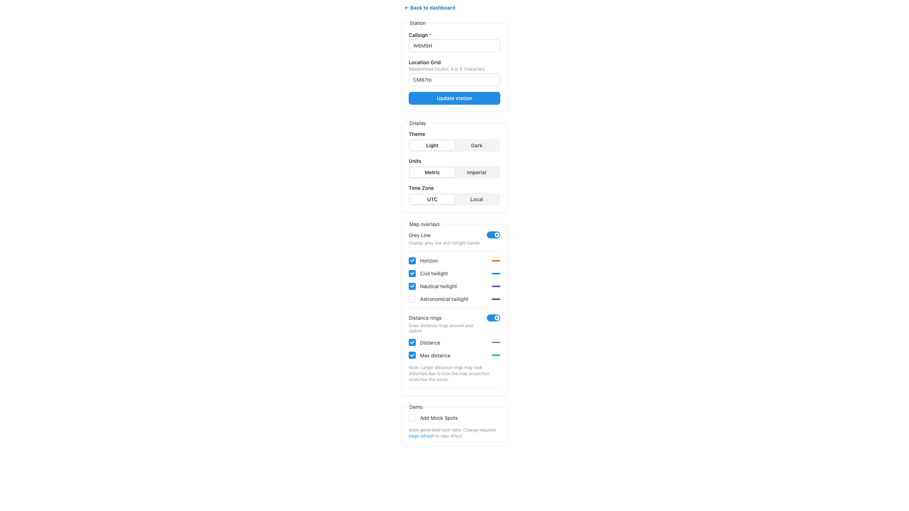
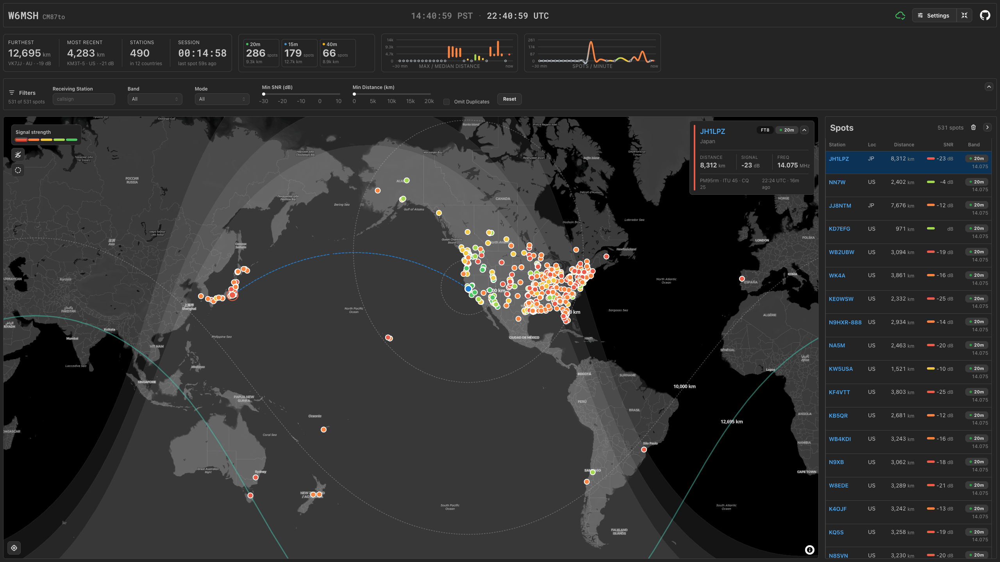

# QSA Dashboard

QSA Dashboard is a web based dashboard created by Mike Chambers (W6MSH) for tracking realtime amateur radio signal propagation for digital modes.

It provides insight into how your signal is propagating, as well as antenna performance and band conditions for the station you are tracking.

You can install it locally or use it at [https://w6msh.mikechambers.com/](https://w6msh.mikechambers.com/).

Data is sourced via MQTT feed from [PSKReporter](https://www.mqtt.pskreporter.info/).

[](images/screenshot-expanded.png?raw=true)

<a href="images/screenshot-collapsed.png"></a>
<a href="images/screenshot-filters.png"></a>
<a href="images/screenshot-settings.png"></a>
<a href="images/screenshot-dark.png"></a>

[Screenshots](images/)

**Features**

- Realtime spot information, including location, distance and strength
- Plot spots on world map
- Filter data
- Light / dark modes
- Charts and data analysis

**Supported Modes**

- FT8
- FT4
- JS8
- VARAC
- CW
- MFSK
- JT9
- JT65
- PSK31
- PSK63
- RTTY
- SSB
- OLIVIA

Spots in any other mode are still shown, with the mode listed as UNKNOWN.

## Installation

### Run Locally

#### Requirements

- [Node.js](https://nodejs.org)
- Online connection

#### Install required modules

```
$ npm install
```

#### Run

```
$ npm run dev
```

Then point your browser to the dev url (printed out in terminal when you run it).

If you want to play around without transmitting, enable the Demo Mode setting in the app's setting screen, which will prepopulate the app with mock spots.

## Usage

### Enter station details

On first launch, you will be prompted to enter your station details.

- _Callsign_ **(required)** : Your amateur radio call sign, or the callsign that you plan to track.
- _Grid Location_ Your [maidenhead grid location](https://www.levinecentral.com/ham/grid_square.php) (4 - 6 chars), used to show your location on the map, determine distance and display propagation routes. It is optional, but without it there is no home marker, path line or distance rings.

Once you have entered your station details, click "Update station" to load the dashboard.

The dashboard URL includes your callsign and grid (for example `/dashboard/W6MSH/FN31`), so you can bookmark or share it.

### Begin transmitting on supported digital modes

Data is obtained from a live feed of propagation submissions to [PSKReporter](https://www.mqtt.pskreporter.info/).

You do not need any particular app to transmit, as long as you are transmitting a supported digital mode.

All that is required is that the receiver is using an app that reports viewed transmissions to PSKReporter (and the app has the reporting enabled).

### Interact with and filter data

Data is retained per session, with a maximum of 3,000 spots (older ones drop off).

You can hover over a spot in the table or on the map to select it, and its details will be displayed.

You can filter the data views via the filter bar. These filters are applied in real time, and affect the table, map and charts:

|          **FILTER** | **DESCRIPTION**                                                 |
| ------------------: | --------------------------------------------------------------- |
|        **Callsign** | Only show spots from receivers whose callsign starts with this. |
|            **Band** | Only show spots from the specified band.                        |
|            **Mode** | Only show spots from the specified mode.                        |
|         **Min SNR** | Hide spots weaker than this.                                    |
|    **Min Distance** | Hide spots closer than this.                                    |
| **Omit Duplicates** | Omit duplicate reports from the same callsign on the same band. |

## Charts

There are currently two charts:

### Max / Median Distance

This creates a floating bar chart displaying the max and median distance for each of the previous 30 minutes.

It is color coded based on the average signal strength (SNR).

### Spots / Minute

This displays the spots per minute, for each of the previous 30 minutes, color coding the line based on the average signal strength.

Note, due to the way that PSKReporter and apps handle duplicate / repeat spots, the initial minute will often be much higher than subsequent minutes, which omit repeated spots.

PSKReporter will resend duplicates, resetting every 5 minutes.

## Settings

The following settings are avaliable by clicking the **Settings** button.

|            SETTING | DESCRIPTION                                                                                                                  |
| -----------------: | ---------------------------------------------------------------------------------------------------------------------------- |
|       **Callsign** | _(required)_ The callsign whose signal you want to track.                                                                    |
|  **Location Grid** | The maidenhead grid location for the specified callsign. Used to show your location on the map and display signal paths.     |
|          **Theme** | The color theme for the UI display. Options are Light or Dark.                                                               |
|          **Units** | The measurement units to display distances in. Metric or Imperial.                                                           |
|      **Time Zone** | The time zone to display time in. Options are UTC or Local (uses system time zone.)                                          |
|      **Grey Line** | Whether to display a greyline overlay, showing the transition between day and night. Can be useful for timing band openings. |
| **Twilight Bands** | Which lines the greyline overlay draws: horizon, civil, nautical and astronomical twilight.                                  |
| **Distance Rings** | Master switch for the distance rings on the map. Needs a location grid. Disabled when both options below are off.            |
|       **Distance** | Draw rings at fixed distances around your location, in your selected units.                                                  |
|   **Max Distance** | Draw a ring at the distance of the furthest spot currently shown.                                                            |
|      **Demo Mode** | Populates the map with demo data. Requires a page refresh when changing settings.                                            |

Settings are saved in your browser's local storage.

## Notes

- The first minute in the charts is often much higher than the minutes after it (see the note under Spots / Minute)
- Distance rings (especially large ones) can look distorted on the map due to how the map is projected

## Development

There are a couple of tests included (mostly for callsign and grid validation), which you can run with:

```
$ npm test
```

### Offline maps (desktop app)

The web version loads its map from [Maptoolkit](https://maptoolkit.org). The desktop app uses map files bundled with it, from [Protomaps](https://protomaps.com), so the map works offline. These files are not checked into git, so you need to download them before you first run or build the desktop app.

#### Requirements

- Online connection (only while downloading)
- `git` and `bash` (on Windows, use Git Bash or WSL)
- The [pmtiles command line tool](https://github.com/protomaps/go-pmtiles/releases) (on macOS: `brew install pmtiles`)

#### Download or update the maps

1. Pick a recent build date from [maps.protomaps.com/builds](https://maps.protomaps.com/builds). Only recent builds are kept.
2. Run the script with that date, in `YYYYMMDD` format:

```
$ npm run fetch-map -- 20261125
```

3. Restart the desktop app, or rebuild it, to pick up the new files.

The files are saved to `src-tauri/resources/map`. Running the script again replaces the tiles.

To change how much detail is included, edit `MAXZOOM` in `scripts/fetch-map.sh`. The default is 6, and each additional level roughly doubles the size of the tiles.

Fonts and icons come from [basemaps-assets](https://github.com/protomaps/basemaps-assets), pinned to a specific commit (`ASSETS_COMMIT` in the same script), so they only change if you update it.

### App icons

All of the icons are built from one file, `design/icon.svg`. To change the icon, edit that file and then run:

```
$ npm run icons
```

This replaces the desktop app icons in `src-tauri/icons` and the website icon, `public/favicon.svg`. Don't edit those by hand, as they are overwritten.

The macOS icons (`icon.icns` and `icon.png`) are given a transparent margin by the script, so they match the size of other icons in the Dock. The artwork needs a `viewBox` on its `<svg>` tag for this to work.

#### Seeing the new icon in the desktop app

The icon is compiled into the app, but changing the icon files alone does not trigger a rebuild, so you may still see the old one. To force a rebuild, update the timestamp on the Tauri config file:

```
$ touch src-tauri/tauri.conf.json
```

If `npx tauri dev` is running it will rebuild right away. Otherwise the new icon is picked up the next time you run or build the app.

## Questions, Feature Requests, Feedback

If you have any questions, feature requests, issues or need help please post on the [issues page](https://github.com/mikechambers/qsa-dashboard-js/issues).

## Acknowledgements

Data is obtained from a live feed of propagation submissions to [mqtt.pskreporter.info](https://www.mqtt.pskreporter.info/), from data submitted to [PSKReporter](https://pskreporter.info).

Built with [React](https://react.dev), [Mantine](https://mantine.dev), [MapLibre GL JS](https://maplibre.org), [Turf.js](https://turfjs.org) for the distance rings and path lines, and the [ham2k](https://github.com/ham2k) libraries for DXCC and grid / distance calculations. Map styles are from [maptoolkit](https://www.maptoolkit.com), using [OpenStreetMap](https://www.openstreetmap.org/copyright) data.

## License

Project released under a [MIT License](LICENSE.md).

[](LICENSE.md)
